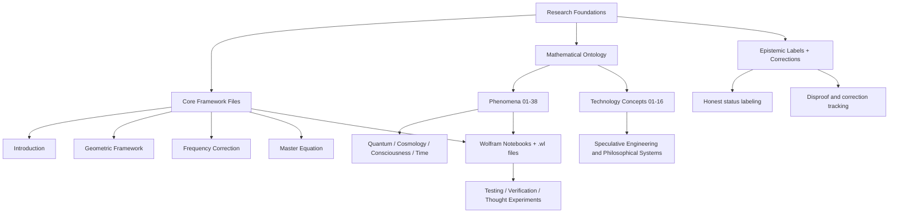
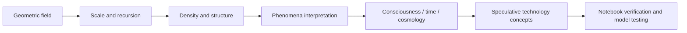

# Research Documentation

A research archive and conceptual map for exploring a speculative mathematical ontology called the Recursive Harmonic Unified Field Theory (RHUFT). This repository is organized as a documentation library, mathematical notebook archive, and exploratory framework for understanding how geometric, recursive, and harmonic structures might relate to physics, consciousness, and the structure of reality.

This project is intentionally documented as a research and philosophy workspace rather than a finished software package. The materials sit between mathematics, theoretical physics, epistemology, and speculative systems thinking.

## Repository purpose

The repository brings together:

- Core framework documents that define the RHUFT ontology
- Phenomenon-by-phenomenon analyses of physics and reality
- Technology and speculative application documents
- Notebook-driven experiments and verification files in Wolfram Language
- Source material, references, and conceptual cross-links

The goal is not to claim established scientific proof, but to preserve and organize a long-form research process in a readable, navigable format.

## Research orientation

At a high level, the project explores the question:

- Can reality be understood as a recursive geometric field?
- What happens if we model physical structure as layered geometric interference, scale dependence, and self-referential closure?
- How do mathematical constants like phi, pi, e, and square roots of 2 and 3 interact in a unified ontology?

The work here is best understood as a structured research archive rather than a conventional application or library.

## Visual overview



## Folder structure

```text
Research-Documentation/
├── Research/
│   ├── RHUFT core notebooks and PDFs
│   ├── mathematical framework documents
│   └── research notes and theory packs
├── The Framework/
│   ├── RHUFT_v5.1_Integrated_Framework.md
│   ├── RHUFT_v6.0_Master_Index.md
│   ├── v6_01_introduction.md
│   ├── v6_02_geometric_framework.md
│   ├── v6_03_frequency_correction.md
│   ├── v6_04_master_equation.md
│   └── additional phenomenon and technology notes
├── Technologies-potential/
│   ├── v6_tech_01_qsps.md
│   ├── v6_tech_02_rfs.md
│   ├── ...
│   └── speculative technology concepts
├── Tests and notebooks/
│   ├── OPF Framework-Package.wl
│   ├── verification notebooks
│   ├── visual tests
│   └── experimental scripts
├── coin/
│   └── crypto-related notes / text files
├── README.md
└── repository metadata
```

## What is inside this repo

### 1. Core framework
The repository includes a set of documents describing a framework called RHUFT. These files define:

- the mathematical ontology behind the work
- key constants and symbolic structures
- a scale-based view of physical reality
- proposed relationships between geometry, information, and time
- epistemic labeling that distinguishes mathematical facts, speculative claims, and corrected or disproven ideas

The strongest orientation is philosophical and interpretive rather than conventional engineering or experimentally validated theory.

### 2. Phenomena mapping
The repo maps the framework onto areas such as:

- mass and inertia
- gravity and black holes
- quantum mechanics and duality
- consciousness and self-reference
- cosmology and time
- vacuum structure and symmetry
- biological and neural interpretation

This is structured as a phenomenon ledger: each concept is treated as a research object, not just a headline claim.

### 3. Technology exploration
The `Technologies-potential` directory contains conceptual, speculative technology ideas, including themes such as:

- quantum sensing
- recursive harmonic computing
- field-based memory
- resonant systems
- consciousness-emulating AI
- neural and bio-geometric interfaces

These are clearly presented as speculative and philosophical, not installed systems or proven devices.

### 4. Wolfram notebooks and verification files
The notebook and `.wl` files suggest a computational exploration mode:

- symbolic models
- verification notebooks
- visual tests
- package-like structures
- exploratory scripts used for mathematical reasoning

This repo is heavily aligned with Wolfram Language workflows.

## Reading path

If you want to understand the work quickly, a good order is:

1. Start with `The Framework/RHUFT_v6.0_Master_Index.md`
2. Read `The Framework/v6_01_introduction.md`
3. Review `The Framework/v6_02_geometric_framework.md`
4. Read `The Framework/v6_03_frequency_correction.md`
5. Read `The Framework/v6_04_master_equation.md`
6. Explore selected phenomenon notes and technology files
7. Open notebook files in Mathematica / Wolfram Notebook format for computational exploration

## Research arc at a glance



## Core themes

### Mathematics and structure
The work repeatedly emphasizes:

- geometry as the substrate of physical interpretation
- recursive self-similarity
- incommensurable constants and scale relations
- harmonic and quasi-periodic organization

### Epistemic discipline
One of the notable features of the repo is its emphasis on labeling claims by status, such as:

- mathematical fact
- observed measurement
- established physics
- speculative idea
- philosophical framework
- corrected / disproven idea

This makes the archive unusually honest about uncertainty and revision.

### Research ethics and humility
The repository does not present itself as a final scientific truth claim. Instead, it presents itself as a system for exploring, documenting, testing, and revising ideas.

## Important caveat

This repository is fundamentally a research archive and speculative framework, not a conventional software project.

It contains:

- mathematical speculation
- philosophical interpretation
- exploratory theoretical models
- unverified technology concepts
- experimental and computational drafts

It should be treated as an intellectual workspace and research dossier, not as a guaranteed physical theory.

## Best way to use the repo

- Use the framework docs as the conceptual backbone
- Use the notebooks to experiment with symbolic and computational ideas
- Use the technology folder to see the applied and speculative extensions
- Use the phenomenon docs to trace how the framework tries to explain different domains
- Treat the epistemic labels as part of the methodology, not just metadata

## Suggested workflow

```text
1. Read the master index
2. Choose one phenomenon area of interest
3. Read the associated framework note
4. Open relevant notebooks and scripts
5. Compare with established physics where necessary
6. Record corrections, follow-up questions, and new hypotheses
```

## Summary

This repository is a documentation-heavy, theory-first research archive focused on a geometric and recursive interpretation of reality. It is rich in ideas, structure, and exploration—but it is best understood as an evolving speculative framework, not a finished scientific product.

The project represents an attempt to organize a large body of theoretical work into a readable and navigable research environment.

## License and use

Repository contents appear to be research and documentation artifacts. If you are using this material in a serious scientific context, you should treat it as speculative and cross-check all claims against peer-reviewed literature and established physics.

## Note for future contributors

A strong next step for this repository would be to add:

- a curated index page per research area
- links between notebooks and corresponding documents
- an integrated glossary of terms and symbols
- a short "how to read this repository" guide for new visitors

---

Built as an exploratory research archive for geometric, recursive, and harmonic inquiry.

